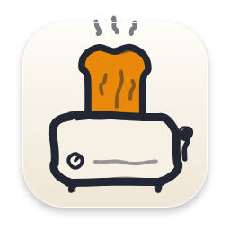
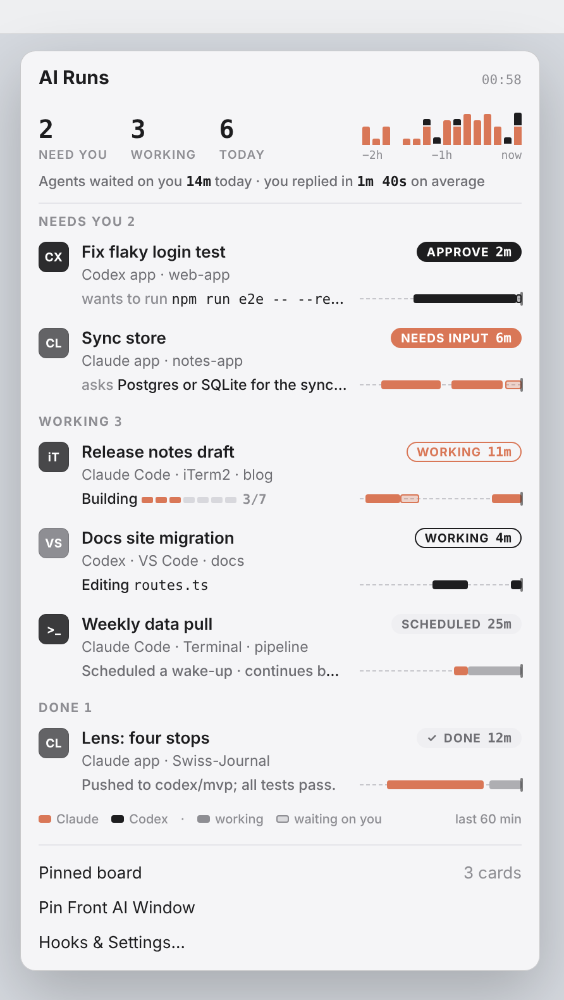

<p align="center"></p>

<h1 align="center">AI Runs</h1>

<p align="center">
A menu bar app for people who run many Claude Code and Codex sessions at once.<br>
See which ones need you, what the rest are doing, and jump back to any of them in one click.
</p>

<p align="center"><a href="README.zh-CN.md">中文说明</a></p>

<p align="center"></p>

When five agents are running in three apps, it's hard to tell which one finished,
which one is waiting for an answer, and which one quietly stopped. AI Runs puts
them all in one list in your menu bar:

- **Needs you** — sessions that ask for approval or for your input, with how long they have waited.
- **Working** — what each one is doing right now ("Building", "Editing routes.ts", step 3 of 7).
- **Done** — finished sessions, out of the way but still there.

Everything stays on your Mac. No account, no server, nothing is sent anywhere.

> **This is an early build for friends to try.** Expect rough edges, and please
> tell me what breaks — see [Feedback](#feedback).

## Install

You need a Mac with Apple silicon (M1 or later) and macOS 14 or later.

1. Download **AI-Runs.zip** from the [latest release](https://github.com/alextang809/ai-runs/releases/latest)
   and unzip it.
2. Drag **AI Runs** into your **Applications** folder.
3. Open it. Because the app isn't notarized by Apple yet, macOS blocks it the
   first time:
   - Open **System Settings → Privacy & Security**, scroll down to
     "AI Runs was blocked…", click **Open Anyway**, and confirm.
   - Or run this once in Terminal:
     `xattr -dr com.apple.quarantine "/Applications/AI Runs.app"`

On an Intel Mac, [build it from source](#build-from-source).

## Set up (2 minutes)

AI Runs opens its settings on first launch.

1. **Claude Code: click Install.** This adds AI Runs to `~/.claude/settings.json`.
   It works for Claude Code in the terminal, in VS Code and in the Claude desktop app.
2. **Codex: click Install**, then open Codex. It shows **Review hooks** with four
   AI Runs hooks — click **Allow all**. Until you do, Codex sends nothing.
3. Start or continue any session. It appears in the menu bar within a second.

macOS may ask for two permissions later, each once:

| When | Permission | Why |
|---|---|---|
| You first click a Terminal or iTerm2 session | Automation | To bring the right tab to the front |
| You first click a Claude app session | Accessibility | To select that thread in Claude's sidebar |

## Can't see the icon?

The icon is three small bars: . If you don't see it:

- **Press ⌥⌘A** — it opens the panel from anywhere.
- **MacBooks with a notch:** icons that don't fit beside the notch are hidden by
  macOS. Remove a few other icons, or use Bartender / Ice and put AI Runs in the
  always-shown section, near the clock.
- In Settings you can also turn on **Also show AI Runs in the Dock**.

## Using it

**Each row** shows the app the session runs in (its real icon), its name (the
same one Claude or Codex shows in its sidebar), its state, where it runs, what
it's doing, and a small timeline of its last hour.

| You see | Means |
|---|---|
| **APPROVE** (solid) | It wants to run a command or edit a file and is waiting for your OK |
| **NEEDS INPUT** (solid) | It asked you a question, or said it's blocked |
| **REPLIED** (light) | It finished a turn, and AI Runs can't tell whether it needs you |
| **WORKING** (outline) | It's running; the line below says what it's doing |
| **SCHEDULED / BACKGROUND** (grey) | It's waiting on its own timer or background task and continues by itself |
| **DONE ✓** (grey) | It finished what you asked |

Colour tells you the tool: **Claude** in its clay orange, **Codex** in black
(white in dark mode). Everything else is grey.

How "done" vs "needs input" is decided, from most to least certain: Claude's
ask-the-user tool, a completed step list, then the wording of the last message
(English and Chinese), then Apple's on-device model on macOS 26. When it can't
tell, it says **REPLIED** rather than guess. Hover a row to see how it decided.

**Click a row** to go back to that session:

| The session runs in | Click does |
|---|---|
| Terminal or iTerm2 | Selects its tab; if the tab was closed, reopens the session in a new tab in the same folder |
| VS Code, Cursor | Opens the project window |
| Codex app | Opens that exact thread |
| Claude app | Brings Claude forward and selects the thread in its sidebar |

**Other things you can do**

- **Remove** a session: hover and click **×**, or right-click → Remove from List.
  **Undo** (⌘Z) for a few seconds. It comes back only when you message it again.
- **Rename**, **Pin to Board** and more: right-click a row, or hover it for details.
- **Pinned board:** keep threads and quick notes you don't want to lose, grouped
  by project. **Show Pinned Board on Screen** turns it into a small floating window;
  drag text or links onto it to make cards.
- **Pin Front AI Window:** pins the browser tab or app you were just in (for
  claude.ai or chatgpt.com chats, which AI Runs can't track automatically yet).

## Privacy

AI Runs only reads and writes files on your Mac:

- It **adds hooks** to `~/.claude/settings.json` and `~/.codex/hooks.json`
  (only entries whose command contains `airuns-hook`; each file is backed up once
  as `*.airuns-backup`). Each hook appends one line to `~/.airuns/events.jsonl`.
- It **reads thread names** from the Claude app's session list and from Codex's
  `~/.codex/state_5.sqlite` (read-only).
- On macOS 26 it may ask **Apple's on-device model** to name a session or judge
  a reply. That runs on your Mac.

It makes no network requests.

## Feedback

Tell me what's confusing, wrong or missing — the most useful things are:

- a screenshot of the panel (blur anything private),
- what you expected to happen, and what happened instead,
- your macOS version and whether you use Claude Code, Codex, or both.

Open an [issue](https://github.com/alextang809/ai-runs/issues) or just message me.

## Uninstall

1. Open AI Runs settings and click **Remove** for Claude Code and for Codex.
2. Quit AI Runs and drag it from Applications to the Trash.
3. Delete its data: `rm -rf ~/.airuns`

## Known limitations

- Sessions on the web (claude.ai, chatgpt.com, cloud agents) aren't tracked yet;
  pin them with Pin Front AI Window.
- Ghostty, Warp and other terminals can't be scripted, so a click brings the app
  forward but can't pick the tab.
- The build is ad-hoc signed, so after each update macOS may ask for the
  Accessibility permission again.
- Usage limits per tool aren't shown yet.

## Build from source

Requires macOS 14 or later and Xcode 16 (or the Swift 6 toolchain).

```sh
git clone https://github.com/alextang809/ai-runs.git
cd ai-runs
./Scripts/package_app.sh
open "build/AI Runs.app"
```

Run the tests with `swift test`.

- `Sources/AIRunsCore` — event parsing, the session state machine, outcome
  detection, the pinned board and the hook installer. No UI; unit tested.
- `Sources/airuns-hook` — the helper the hooks call.
- `Sources/AIRunsApp` — the menu bar app (AppKit + SwiftUI).
- `collab/` — notes from Claude and Codex working on this project together.

## License

MIT
