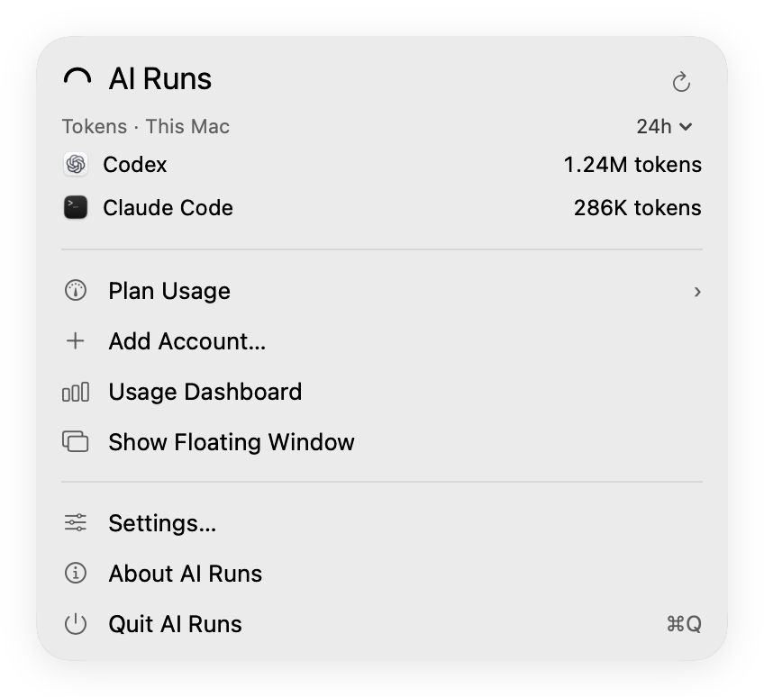
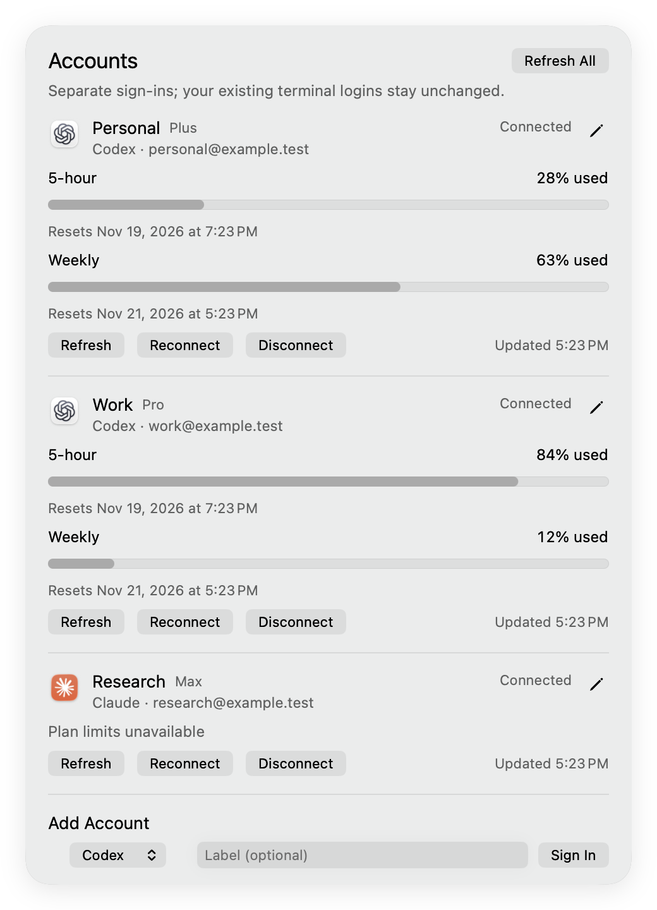

<p align="center"></p>

<h1 align="center">AI Runs</h1>

<p align="center">
A menu bar app for people who run many Claude Code and Codex sessions at once.<br>
See which ones need you, what the rest are doing, and jump back to any of them in one click.
</p>

<p align="center"><a href="README.zh-CN.md">中文说明</a></p>

<p align="center"></p>
<p align="center"><sub><i>Illustration with made-up sessions.</i></sub></p>

When five agents are running in three apps, it's hard to tell which one finished,
which one is waiting for an answer, and which one quietly stopped. AI Runs puts
them all in one list in your menu bar:

- **Needs you** — sessions that ask for approval or for your input, with how long they have waited.
- **Working** — running sessions, with elapsed time, readable activity and plan progress when available.
- **Done** — finished sessions, shown below the active ones; fold the group when you want more room.

Session tracking and token statistics stay on your Mac. Optional account
connections sign in directly through the provider's CLI; there is no AI Runs server.

> **Latest release: 1.0.1.** The usage/account features below require a source build until the next release.
> For bugs and feature requests, see [Feedback](#feedback).

## Install

You need a Mac with Apple silicon (M1 or later) and macOS 14 or later.

1. Download **AI-Runs.zip** from the [latest release](https://github.com/alextang809/ai-runs/releases/latest)
   and unzip it.
2. Drag **AI Runs** into your **Applications** folder.
3. Open it. Because the app isn't notarized by Apple yet, macOS blocks it the
   first time:
   - Open **System Settings → Privacy & Security**, scroll down to
     "AI Runs was blocked…", click **Open Anyway**, and confirm.
   - Or run this once in Terminal:
     `xattr -dr com.apple.quarantine "/Applications/AI Runs.app"`

On an Intel Mac, [build it from source](#build-from-source).

## Set up (2 minutes)

AI Runs opens its settings on first launch. To open them again later, click the
menu bar icon (or press ⌥⌘A) and choose **Settings…** at the bottom of the panel.

1. **Claude Code: click Install.** This adds AI Runs to `~/.claude/settings.json`.
   It works for Claude Code in the terminal, in VS Code and in the Claude desktop app.
2. **Codex: click Install**, then open Codex. It shows **Review hooks** with four
   AI Runs hooks — click **Allow all**. Until you do, Codex sends nothing.
3. Start or continue any session. It appears in the menu bar within a second.

macOS may ask for these permissions later, each once:

| When | Permission | Why |
|---|---|---|
| You first click a Terminal or iTerm2 session | Automation | To bring the right tab to the front |
| You first click a Claude app session, or turn on Claude project threads | Accessibility | To select that thread in Claude's sidebar, and to read Claude's Threads list |
| A session first needs you | Notifications | A banner when a session asks for approval or input (turn kinds on or off in Settings) |

### ChatGPT and Claude in the browser (optional)

If you chat on chatgpt.com or claude.ai, AI Runs can follow those too (Chrome,
Arc, Brave, Edge, Vivaldi; not Safari yet):

1. In AI Runs settings, under **Browser**, click **Connect Browsers**, then
   **Show Extension Folder**.
2. In your browser open `chrome://extensions` (or `arc://`, `brave://`,
   `edge://extensions`), turn on **Developer mode**, click **Load unpacked** and
   choose that folder.
3. Reload your ChatGPT and Claude tabs. Click the AI Runs icon in the browser
   toolbar to check it says "Connected".

Each conversation then shows up while it's writing, with its title; you get a
notification when the reply is ready, and a click brings back that exact tab.

## Can't see the icon?

The icon is an arc over a dot, a musical *fermata*: "hold until the conductor gives
the cue". Arc alone: nothing running. Arc and dot: runs in progress. Amber dot and a
number: that many are holding for you.

<p align="center"></p>
<p align="center"><sub><i>Illustration.</i></sub></p>

If you don't see it:

- **Press ⌥⌘A** — it opens the panel from anywhere.
- **MacBooks with a notch:** icons that don't fit beside the notch are hidden by
  macOS. Remove a few other icons, or use Bartender / Ice and put AI Runs in the
  always-shown section, near the clock.
- In Settings you can also turn on **Also show AI Runs in the Dock**.

## Using it

**The overview** shows Needs you, Working and Today counts, a two-hour activity
chart and today's waiting time.

**Each row** shows the app's real icon, the session name (the same one Claude or
Codex shows in its sidebar), state and elapsed time, plus readable activity or
current plan progress and a small history bar. Approval requests and input
questions use the full activity line. A branch symbol warns when other sessions
are working in the same repository. Hover for source, project and full details.
Done starts expanded and can be folded; Ignored starts collapsed. Long lists scroll
while Settings and the floating-window control stay visible. The pinned board
lives in the floating window, leaving the main menu for sessions.

| You see | Means |
|---|---|
| **APPROVE** (solid) | It wants to run a command or edit a file and is waiting for your OK |
| **NEEDS INPUT** (solid) | It asked you a question, or said it's blocked |
| **REPLIED** (light) | It finished a turn, and AI Runs can't tell whether it needs you |
| **WORKING** (outline) | It's running; the line below shows activity or current plan progress |
| **NO UPDATE** (grey) | It was working, but nothing has arrived for 30 minutes; it may have stopped |
| **SCHEDULED / BACKGROUND** (grey) | It's waiting on its own timer or background task and continues by itself |
| **DONE ✓** (grey) | It finished what you asked |

Colour tells you the tool: **Claude** in its clay orange, **Codex** in black
(white in dark mode). Everything else is grey.

How "done" vs "needs input" is decided, from most to least certain: Claude's
ask-the-user tool, a completed step list, then the wording of the last message
(English and Chinese), then Apple's on-device model on macOS 26. When it can't
tell, it says **REPLIED** rather than guess. Hover a row to see how it decided.

**Click a row** to go back to that session:

| The session runs in | Click does |
|---|---|
| Terminal or iTerm2 | Selects its tab; if the tab was closed, reopens the session in a new tab in the same folder |
| VS Code, Cursor | Opens the project window |
| Codex app | Opens that exact thread |
| Claude app | Brings Claude forward and selects the thread in its sidebar |
| A Claude project thread | Opens that exact thread in the Claude app |
| chatgpt.com, claude.ai (with the extension) | Selects that tab in your browser, or reopens the chat there |

**Claude project conversations and threads**

- A thread in a Claude project gets **one row**, with its source in the hover details. Local
  Claude Code sessions that work for that thread don't get rows of their own; the
  newest one tells the row what it's doing.
- Threads that work only in the cloud send AI Runs nothing. While Claude's
  **Threads** list is on screen, AI Runs reads it through Accessibility (read-only,
  only the Claude app) and shows those threads with Claude's own words:
  **WORKING**, **WAITING ON YOU**, **READY FOR REVIEW**, **IDLE**. The hover details
  say when it was seen; after 10 minutes without seeing the thread it says
  **LAST SEEN** instead of a state (Waiting on you is kept).
- The project main conversation and an opened child thread also appear in the
  same list. A page without state evidence says **STATE UNKNOWN** and adds no
  Working or Needs you count. Opening a page does not refresh an older state.
  Main conversations and child threads have their own direct open/pin links.
- Turn this off in Settings → **Claude project threads** ("Show Claude project
  conversations and threads").

**Other things you can do**

- **Remove** a session: hover and click **×**, or right-click → Remove from List.
  **Undo** (⌘Z) for a few seconds. It comes back when you message it again, or
  when it asks for approval.
- **Ignore for Now:** a session waiting for your input or reply (not APPROVE)
  can be set aside from its hover card, right-click menu, notification (**Ignore**)
  or the floating window. It moves to an **Ignored** group, isn't counted and
  doesn't remind you, and comes back by itself when it does something new.
  **Stop Ignoring** undoes it.

  <p align="center"></p>
  <p align="center"><sub><i>Illustration: hover a row for its details and actions.</i></sub></p>
- **Rename**, **Pin to Board** and more: right-click a row, or hover it for details.
- **Floating window:** click **Floating Window** at the bottom of the panel. A small capsule stays on
  top of every app, Space and full-screen window, including Stage Manager sets,
  showing how many sessions need you. Switching apps or waking your Mac restores
  it without taking keyboard focus. Click it for your runs and the pinned board;
  drag it anywhere (it snaps to edges). Click **Floating Window** again to keep it hidden
  until you show it again. Automatic expansion when something needs you is off
  by default (Settings) and applies only while the window is already shown.
- **Pinned board:** keep threads and quick notes you don't want to lose, grouped
  by project, in the floating window's Pinned tab. Drag text or links onto it to
  make cards.
- **Notifications:** a banner when a session asks for approval or input, with
  Open and Snooze. Choose which moments in Settings.
- **Pin Front AI Window** (the **…** menu at the bottom of the panel): pins the browser tab or app you
  were just in to the board.

## Token usage and accounts

**Tokens · This Mac** shows recorded Codex and Claude Code usage. The default is
the **last 24 hours**; switch to Today (your local day) or 7d (the last 168 hours).
Click a provider for input, output, cached reads/writes and model details, or open
**Usage Dashboard**. Cached tokens are already included in input; reasoning is
already included in output. They are not added to the total twice.

The initial scan runs in the background, then reads changed files incrementally.
**Scanning**, **Partial** and **No local records** have distinct meanings. A missing
source is not shown as zero. Browser and cloud-only activity without supported
local usage records is outside these totals. Removing a session from the menu
does not remove its recorded usage.

**Add Account…**, **Usage Dashboard** and **Status Page** are always available
from the main menu. When no sessions are active, completed and ignored sessions
are available under **Recent Sessions**. Unknown states stay visible without
being counted as active.

**Add Account…** supports separate Codex and claude.ai subscription sign-ins and
multiple named accounts. Install the provider's command-line app first. Each
connection gets a private AI Runs profile; your existing terminal and desktop
sign-ins are not switched. Accounts can be renamed, refreshed, reconnected or
disconnected. Disconnecting preserves local history.

**Plan Usage** shows the connected account's available quota windows and reset
times. Codex supplies these through its app server. Claude's documented sign-in
commands do not provide standalone quota readings, so that connection shows its
availability explicitly. Quota windows are separate from the selected token
period, and this Mac's token totals are not attributed to a newly added account.

<p align="center"></p>
<p align="center"></p>
<p align="center"><sub><i>Illustrations with fictitious accounts and usage.</i></sub></p>

## Privacy

Session tracking and token history are processed locally:

- It **adds hooks** to `~/.claude/settings.json` and `~/.codex/hooks.json`
  (only entries whose command contains `airuns-hook`; each file is backed up once
  as `*.airuns-backup`). Each hook appends one line to `~/.airuns/events.jsonl`.
- It **reads thread names** from the Claude app's session list and from Codex's
  `~/.codex/state_5.sqlite` (read-only).
- It reads supported local Codex and Claude usage logs without changing them.
  Its private usage cache keeps counts, timestamps, model and request identities,
  and complete-line checkpoints; it does not store conversation bodies or raw
  transcript fragments.
- The optional **browser extension** reads only chatgpt.com and claude.ai pages:
  the conversation's address and title, whether it is writing, your last message
  and the end of the reply. It hands them to AI Runs on this Mac through the
  browser's native messaging; it has no other permissions and no network access.
- On macOS 26 it may ask **Apple's on-device model** to name a session or judge
  a reply. That runs on your Mac.

Optional account connections run the provider CLI for sign-in and plan refresh.
Credentials stay in isolated CLI-managed profiles or the macOS Keychain; AI Runs
does not import native login files or browser cookies. Account metadata and local
usage caches live under `~/.airuns`. Conversations are not uploaded to an AI Runs
service. Session tracking and local token statistics work without connecting an account.

## Feedback

Tell me what's confusing, wrong or missing — the most useful things are:

- a screenshot of the panel (blur anything private),
- what you expected to happen, and what happened instead,
- your macOS version and whether you use Claude Code, Codex, or both.

Open an [issue](https://github.com/alextang809/ai-runs/issues) or just message me.

## Uninstall

1. Disconnect optional accounts in **Plan Usage & Accounts…**, then open AI Runs settings (**Settings…** in the panel) and click **Remove**
   for Claude Code and for Codex.
   If you added the browser extension, remove it in your browser's extensions page.
2. Quit AI Runs and drag it from Applications to the Trash.
3. Delete its data: `rm -rf ~/.airuns`

## Known limitations

- Web chats need the browser extension, and Safari isn't supported yet. Codex cloud
  isn't tracked. Open Claude project conversations and child threads appear
  together; their state comes from the visible Threads list or agent events.
  When no state is available, AI Runs shows STATE UNKNOWN.
- ChatGPT and Claude change their pages often; if the extension stops noticing
  replies, tell me.
- Ghostty, Warp and other terminals can't be scripted, so a click brings the app
  forward but can't pick the tab.
- Downloaded ad-hoc builds may need Accessibility again after updates. Local
  builds can reuse a signing identity with the setup below.
- Usage limits per tool aren't shown yet.

## Build from source

Requires macOS 14 or later and Xcode 16.3 or later (Swift 6.1 or later).

```sh
git clone https://github.com/alextang809/ai-runs.git
cd ai-runs
./Scripts/make_signing_identity.sh
./Scripts/install_local.sh
```

If macOS asks to let `codesign` use the local key, enter your login keychain
password in the macOS dialog and choose **Always Allow**. The setup script
checks signing before installation and never reads that password. Allow
Accessibility once in AI Runs settings. Later builds reuse the same identity;
keep one app copy in `/Applications/AI Runs.app`.

Run `swift test` and `bash Tests/Scripts/local_signing.test.sh` for the core
and signing-script tests.

- `Sources/AIRunsCore` — event parsing, the session state machine, outcome
  detection, the pinned board and the hook installer. No UI; unit tested.
- `Sources/airuns-hook` — the helper the hooks call.
- `Sources/AIRunsApp` — the menu bar app (AppKit + SwiftUI).
- `collab/` — notes from Claude and Codex working on this project together.

## License

MIT
