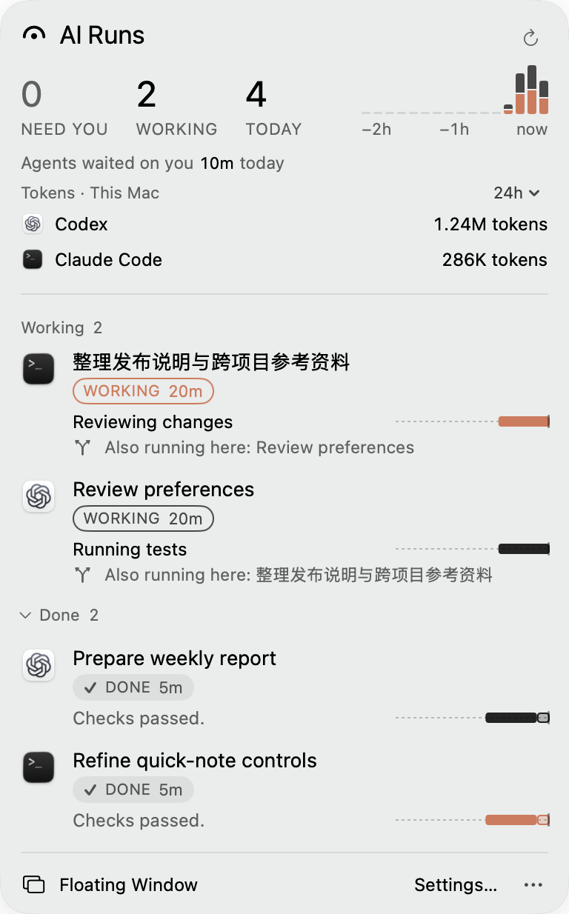
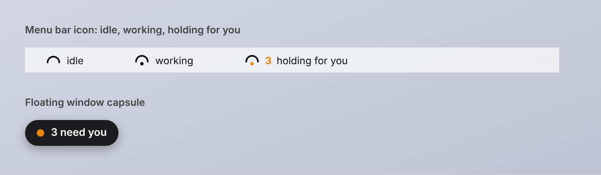
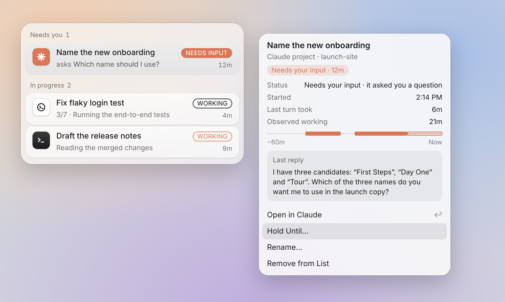
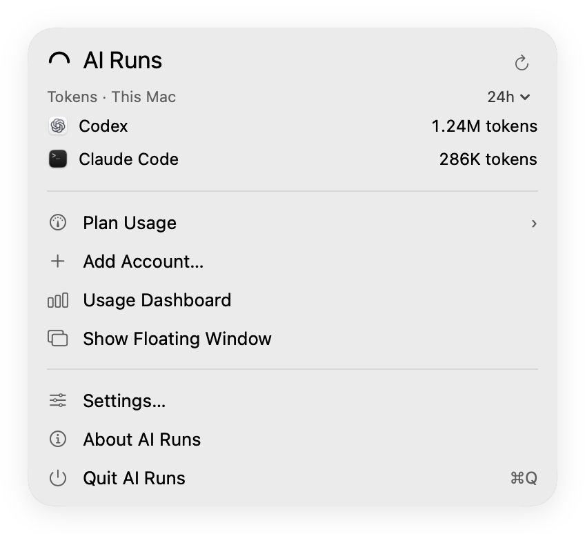
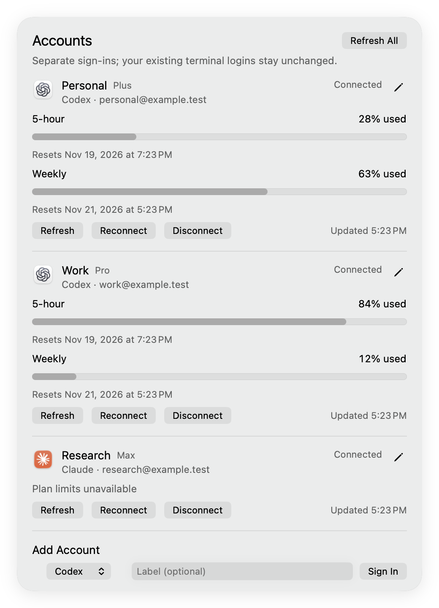

<p align="center"></p>

<h1 align="center">AI Runs</h1>

<p align="center">
给同时开很多个 Claude Code、Codex 会话的人用的 macOS 菜单栏小工具。<br>
一眼看到哪些在等你、其余的在干嘛，点一下就回到那个会话。
</p>

<p align="center"><a href="README.md">English</a></p>

<p align="center"></p>
<p align="center"><sub><i>示意图，会话内容是虚构的。</i></sub></p>

三个 App 里同时跑着五个 agent 的时候，很难分清哪个做完了、哪个在等你回答、哪个其实已经停了。AI Runs 把它们放进菜单栏里的同一个列表：

- **Needs you（等你）**：等你批准、等你回答的会话，并显示已经等了多久。
- **Working（在跑）**：运行中的会话、已用时长、可读的活动描述，以及有依据的计划进度。
- **Done（做完）**：已经完成的会话，放在最下面，不打扰你。

会话追踪和 token 统计都在 Mac 本地处理。可选的账号连接通过服务商 CLI 直接登录，不经过 AI Runs 服务器。

> **最新发布版 1.0.1。**下面介绍的用量／账号功能目前需要从源码构建，待下次发布再进入下载包。遇到问题或有功能建议，欢迎通过[反馈](#反馈)告诉我。

## 安装

需要 Apple 芯片（M1 及以后）的 Mac，macOS 14 或更新版本。

1. 从[最新发布页](https://github.com/alextang809/ai-runs/releases/latest)下载 **AI-Runs.zip** 并解压。
2. 把 **AI Runs** 拖进「应用程序」文件夹。
3. 打开它。因为还没有经过苹果公证，第一次打开会被 macOS 拦下：
   - 打开「系统设置 → 隐私与安全性」，往下找到"已阻止 AI Runs…"，点 **仍要打开**，再确认一次；
   - 或者在终端里运行一次：
     `xattr -dr com.apple.quarantine "/Applications/AI Runs.app"`

Intel 芯片的 Mac 请[从源码构建](#从源码构建)。

## 设置（2 分钟）

第一次打开时，AI Runs 会自动弹出设置窗口。以后想再打开，点菜单栏图标（或按 ⌥⌘A），在面板最下面选 **Settings…**。

1. **Claude Code：点 Install。**这会在 `~/.claude/settings.json` 里加上 AI Runs。终端里、VS Code 里、Claude 桌面版里的 Claude Code 都能被识别。
2. **Codex：点 Install，然后打开 Codex。**它会弹出 **Review hooks**，里面有 4 个 AI Runs 的 hook，点 **Allow all**。不点的话，Codex 什么都不会发过来。
3. 新开或继续任意一个会话，一秒内就会出现在菜单栏里。

之后 macOS 可能会各问一次下面几个权限：

| 什么时候 | 权限 | 用途 |
|---|---|---|
| 第一次点终端（Terminal 或 iTerm2）里的会话 | 自动化 | 把对应的标签页切到前面 |
| 第一次点 Claude 桌面版里的会话，或打开 Claude project threads | 辅助功能 | 在 Claude 侧边栏里选中那个线程，并读取 Claude 的 Threads 列表 |
| 第一次有会话等你 | 通知 | 有会话等你批准或回答时弹出横幅（在设置里选哪些情况要通知） |

### 浏览器里的 ChatGPT 和 Claude（可选）

如果你在 chatgpt.com 或 claude.ai 上聊天，AI Runs 也能跟踪这些对话。支持 Chrome、Arc、Brave、Edge、Vivaldi，暂不支持 Safari。

1. 在 AI Runs 设置的 **Browser** 区，先点 **Connect Browsers**，再点 **Show Extension Folder**。
2. 在浏览器里打开 `chrome://extensions`（Arc、Brave、Edge 分别是 `arc://`、`brave://`、`edge://extensions`），打开右上角的 **开发者模式**，点 **加载已解压的扩展程序**，选刚才那个文件夹。
3. 刷新 ChatGPT 和 Claude 的标签页。点浏览器工具栏上的 AI Runs 图标，显示"Connected"就说明连上了。

之后每个对话在生成时都会出现在列表里，带着它的标题。回复写好了会通知你，点一下就切回那个标签页。

## 菜单栏里找不到图标？

图标是一道弧加下面一个点，也就是乐谱里的延长记号，意思是"保持，直到指挥给手势"。只有弧：没有会话在跑。弧加点：有会话在跑。点变成橙色并带数字：有这么多个会话在等你。

<p align="center"></p>
<p align="center"><sub><i>示意图。</i></sub></p>

如果看不到：

- **按 ⌥⌘A**，在任何地方都能打开面板。
- **带刘海的 MacBook：**刘海旁边放不下的图标会被 macOS 自动藏起来。可以去掉几个别的图标，或者在 Bartender / Ice 里把 AI Runs 放进始终显示区，靠近时钟的位置。
- 也可以在设置里打开 **Also show AI Runs in the Dock**，让它同时出现在程序坞里。

## 怎么用

**顶部概览**显示 Needs you、Working、Today 计数、最近两小时的活动图和今天的等待时长。

**每一行**显示会话所在 App 的真实图标、会话名字（和 Claude、Codex 侧边栏里的一样）、状态和时长，并显示可读活动或当前计划进度及小历史条。审批请求和输入问题使用完整的活动行。分叉图标表示同一仓库还有其他会话正在运行；来源、项目和完整细节放在悬停卡片里。Done 默认展开，可手动折叠；Ignored 默认折叠。会话较多时列表可滚动，底部设置和浮窗按钮保持可见。钉板只放在浮窗里，主菜单专注显示会话。

| 你看到的 | 意思 |
|---|---|
| **APPROVE**（实心） | 它想执行命令或改文件，在等你批准 |
| **NEEDS INPUT**（实心） | 它问了你问题，或者说自己卡住了 |
| **REPLIED**（浅色） | 它结束了这一轮，但 AI Runs 判断不出它是否需要你 |
| **WORKING**（描边） | 它在跑，下面显示活动描述或当前计划进度 |
| **NO UPDATE**（灰色） | 它本来在跑，但已经 30 分钟没有任何动静，可能已经停了 |
| **SCHEDULED / BACKGROUND**（灰色） | 它在等自己定的唤醒任务或后台任务，会自己接着跑 |
| **DONE ✓**（灰色） | 你交代的事它做完了 |

颜色只用来区分工具：**Claude** 是它的陶土橙，**Codex** 是黑色（深色模式下是白色），其他都是灰色。

"做完了"还是"需要你输入"，按可靠程度从高到低这样判断：
1. Claude 调用了专门向你提问的工具；
2. 它的步骤清单全部完成；
3. 它最后一段话的措辞（中英文都认）；
4. macOS 26 上交给苹果的本机模型判断。

判断不出来就显示 **REPLIED**，不瞎猜。鼠标停在某一行上，能看到它是怎么判断的。

**点一下某一行**，就回到那个会话：

| 会话在哪里跑 | 点一下会 |
|---|---|
| Terminal 或 iTerm2 | 切到它的标签页；标签页关了，就在同一个文件夹里新开一个标签页接着跑 |
| VS Code、Cursor | 打开那个项目的窗口 |
| Codex 桌面版 | 直接打开那个线程 |
| Claude 桌面版 | 把 Claude 带到前台，并在侧边栏里选中那个线程 |
| Claude 项目里的 thread | 在 Claude 桌面版里直接打开那个 thread |
| chatgpt.com、claude.ai（装了插件） | 切到浏览器里那个标签页；标签页关了就在那个浏览器里重新打开 |

**Claude 项目主对话和 thread**

- Claude 项目里的每个 thread 只占**一行**，来源放在悬停详情里。替这个 thread 干活的本地 Claude Code 会话不再单独占行，由最新的那个告诉这一行它在做什么。
- 只在云端跑的 thread 不会给 AI Runs 发任何东西。当 Claude 的 **Threads** 列表显示在屏幕上时，AI Runs 通过辅助功能读取它（只读，只读 Claude 这个 App），用 Claude 自己的词显示状态：**WORKING**、**WAITING ON YOU**、**READY FOR REVIEW**、**IDLE**。悬停详情会说明上次看到它的时间；超过 10 分钟没再看到这个 thread，就显示 **LAST SEEN**，不再显示状态（Waiting on you 会保留）。
- 项目主对话和当前打开的子线程也显示在同一列表中。页面没有提供状态时显示 **STATE UNKNOWN**，不增加 Working 或 Needs you 计数。打开页面不会刷新旧状态的观察时间。主对话和子线程都有独立的打开、钉选链接。
- 可以在设置的 **Claude project threads** 里关掉（"Show Claude project conversations and threads"）。

**其他功能**

- **移除会话：**鼠标移上去点 **×**，或者右键 → Remove from List。之后几秒内可以点 **Undo**（⌘Z）撤销。移除后，只有你在那个会话里再发消息，或者它请求你批准时，它才会回来。
- **Ignore for Now（先不管）：**在等你回答或回复的会话（APPROVE 不行）可以先放一边：在悬停卡片、右键菜单、通知（**Ignore**）或悬浮窗里都能点。它会移到 **Ignored** 分组，不计数、不提醒，等它有新动静时自己回来。点 **Stop Ignoring** 撤销。

  <p align="center"></p>
  <p align="center"><sub><i>示意图：鼠标停在某一行上看详情和操作。</i></sub></p>
- **改名、置顶到钉板**等：右键某一行，或者把鼠标停在上面看详情。
- **悬浮窗：**在面板最下面点 **Floating Window**。一个小胶囊会停在所有 App、所有桌面、全屏窗口的上面，也支持台前调度（Stage Manager），显示有几个会话在等你。切换 App 或唤醒 Mac 后会恢复显示，不抢走键盘焦点。点一下展开，能看到会话列表和钉板；可以拖到任何地方，靠近屏幕边缘会自动吸附。点 **Floating Window** 后会保持隐藏，直到你再次显示它。有会话等你时自动展开的功能默认关闭，可在设置里打开，只对已经显示的悬浮窗生效。
- **钉板：**在悬浮窗的 Pinned 标签里，按项目分组，记下不想丢的线程和随手的笔记。往里拖文字或链接就会生成卡片。
- **通知：**有会话等你批准或回答时弹出横幅，可以直接点 Open 跳过去，或点 Snooze 稍后提醒。在设置里选择哪些情况要通知。
- **Pin Front AI Window**（面板底部 **…** 菜单）：把你刚才在用的浏览器标签页或 App 钉到钉板上。

## Token 用量与账号

**Tokens · This Mac** 显示本机记录的 Codex、Claude Code 用量，默认**最近 24 小时**，也能切换 Today（本地自然日）和 7d（最近 168 小时）。点击服务商查看输入、输出、缓存读写和模型明细，或打开 **Usage Dashboard**。缓存已经包含在输入里，推理已经包含在输出里，不会重复加到总量。

首次在后台扫描，之后增量读取变化的文件。Scanning（扫描中）、Partial（不完整）和 No local records（没有本地记录）会分别显示；读不到的数据不会显示成零。没有受支持本地记录的网页、纯云端活动不在统计范围内。从菜单移除会话不会删除其已记录的用量。

没有活跃会话时，菜单作为用量首页，提供 **Add Account…**、**Usage Dashboard**、浮窗开关和设置。已完成、已忽略的会话可从 **Recent Sessions** 展开；未知状态仍会显示，不算作活跃。

**Add Account…** 支持独立登录 Codex、claude.ai 订阅账号，并管理多个有自定义名称的账号。需要先安装相应服务商的 CLI。每个连接使用 AI Runs 的独立私有配置目录，不会切换现有终端或桌面 App 的登录。可以改名、刷新、重新连接或断开账号；断开后保留本机历史记录。

**Plan Usage** 显示已连接账号可取得的额度窗口和重置时间。Codex 通过 app server 提供；Claude 的公开登录命令不能独立读取额度时，会明确显示不可用。账号额度窗口和 token 的时间范围分开，本机 token 总量也不会直接归到新添加的账号上。

<p align="center"></p>
<p align="center"></p>
<p align="center"><sub><i>图中账号和用量均为虚构示例。</i></sub></p>

## 隐私

会话追踪和 token 历史都在本机处理：

- 它会在 `~/.claude/settings.json` 和 `~/.codex/hooks.json` 里**添加 hook**。只动命令里含有 `airuns-hook` 的条目，每个文件第一次改动前会备份成 `*.airuns-backup`。每个 hook 只是往 `~/.airuns/events.jsonl` 里追加一行记录。
- 它会从 Claude 桌面版的会话列表、Codex 的 `~/.codex/state_5.sqlite` 里**读取线程名字**（只读）。
- 它只读受支持的 Codex、Claude 本地用量日志，不修改源文件。私有用量缓存只保留计数、时间、模型、请求身份和完整行读取位置，不保存对话正文或原始日志片段。
- 可选的**浏览器插件**只读取 chatgpt.com 和 claude.ai 的页面：对话地址和标题、是否在生成、你的最后一条消息和回复的结尾。这些信息通过浏览器的 native messaging 交给本机的 AI Runs。插件没有别的权限，也不联网。
- 在 macOS 26 上，它可能会用**苹果的本机模型**给会话起名、判断回复，模型在你的 Mac 上运行。

可选的账号连接会调用服务商 CLI 完成登录和额度刷新。凭据由独立 CLI 配置或 macOS 钥匙串管理，不导入原有登录文件或浏览器 Cookie。账号元数据和本机用量缓存放在 `~/.airuns`，对话不会上传到 AI Runs 服务。不连接账号也能使用会话追踪和本机 token 统计。

## 反馈

哪里看不懂、不对、缺了什么，都请告诉我。最有用的是：

- 面板的截图（隐私内容可以打码）；
- 你本来以为会怎样，实际又发生了什么；
- 你的 macOS 版本，以及你用的是 Claude Code、Codex，还是两个都用。

可以在 GitHub 上[提 issue](https://github.com/alextang809/ai-runs/issues)，也可以直接发消息给我。

## 卸载

1. 先在 **Plan Usage & Accounts…** 断开可选账号，再打开 AI Runs 的设置（面板里的 **Settings…**），分别在 Claude Code 和 Codex 那一行点 **Remove**。装了浏览器插件的话，在浏览器的扩展程序页面把它移除。
2. 退出 AI Runs，把它从「应用程序」拖到废纸篓。
3. 删除它的数据：`rm -rf ~/.airuns`

## 已知限制

- 网页对话需要装浏览器插件，暂不支持 Safari。Codex cloud 还没法跟踪。Claude 项目主对话和子线程可以从打开的页面识别；状态来自 Threads 列表或 agent 事件，无法确认时显示 STATE UNKNOWN。
- ChatGPT 和 Claude 的网页经常改版。如果插件突然认不出回复了，请告诉我。
- Ghostty、Warp 等终端不支持脚本控制，点一下只能把那个 App 带到前台，选不中具体的标签页。
- 现在的版本是临时签名，每次更新后 macOS 可能会要你重新打开一次辅助功能权限。
- 还不能显示各个工具的剩余用量。

## 从源码构建

需要 macOS 14 或更新版本，以及 Xcode 16.3 或更新版本（Swift 6.1 或更新）。

```sh
git clone https://github.com/alextang809/ai-runs.git
cd ai-runs
./Scripts/make_signing_identity.sh
./Scripts/install_local.sh
```

如果 macOS 询问是否允许 `codesign` 使用本机密钥，请在系统对话框里输入登录钥匙串密码，并选择 **Always Allow（始终允许）**。脚本会先检查签名是否可用，不会读取密码。随后在 AI Runs 设置中授予一次辅助功能权限。后续构建复用同一签名身份，只保留 `/Applications/AI Runs.app` 这一份应用。

用 `swift test` 和 `bash Tests/Scripts/local_signing.test.sh` 运行核心和签名脚本测试。

- `Sources/AIRunsCore`：事件解析、会话状态机、判断做完还是要你输入、钉板和 hook 安装。没有界面，有单元测试。
- `Sources/airuns-hook`：hook 调用的小工具。
- `Sources/AIRunsApp`：菜单栏 App 本身（AppKit + SwiftUI）。
- `collab/`：Claude 和 Codex 一起做这个项目时留下的笔记。

## 许可证

MIT
